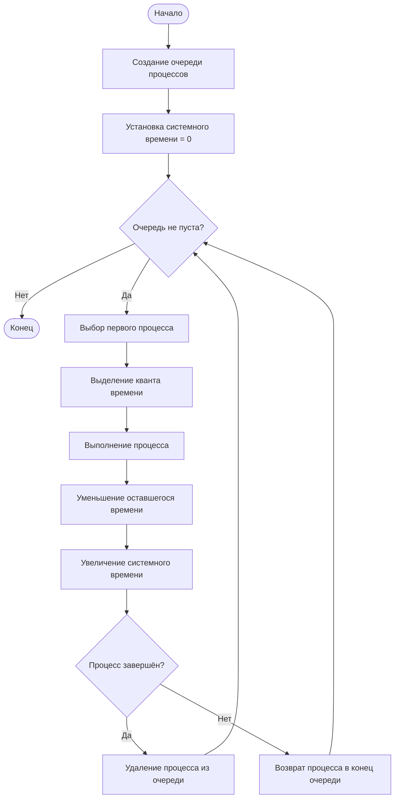
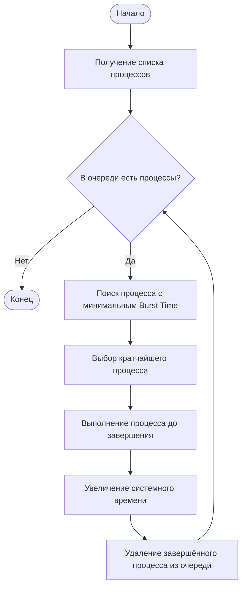

# Тема 11. Имитационное моделирование планировщика задач (FIFO, SJF, Round Robin)

> **Над чем придётся подумать:** смоделировать дискретное системное время, очередь ожидания и вытеснение задач по кванту времени (Round Robin), чтобы короткие задачи не ждали часами.

---

## Содержание

1. [Теоретическая часть](#1-теоретическая-часть)
   - [1.1. Планировщик задач](#11-планировщик-задач)
   - [1.2. FIFO](#12-fifo-first-in-first-out)
   - [1.3. SJF](#13-sjf-shortest-job-first)
   - [1.4. Round Robin](#14-round-robin)
2. [Очередь процессов](#2-очередь-процессов)
3. [Дискретное системное время](#3-дискретное-системное-время)
4. [Расчёт времени ожидания](#4-расчёт-времени-ожидания)
5. [Блок-схемы алгоритмов](#5-блок-схемы-алгоритмов)
6. [Практическая реализация](#6-практическая-реализация)
7. [Сравнение алгоритмов](#7-сравнение-алгоритмов)
8. [Вывод](#8-вывод)

---


## 1. Теоретическая часть

### 1.1. Планировщик задач

**Планировщик задач (Scheduler)** — компонент операционной системы, распределяющий процессорное время между процессами.

В современных ОС одновременно существует множество процессов, претендующих на CPU. Поскольку ресурс процессора ограничен, ОС должна определять порядок выполнения задач — для этого и используются алгоритмы планирования.

**Основные задачи планировщика:**

- распределение процессорного времени между процессами;
- определение очерёдности выполнения задач;
- сокращение времени ожидания процессов;
- обеспечение справедливого распределения ресурсов;
- повышение эффективности использования процессора.

В данной работе рассматриваются три алгоритма: **FIFO**, **SJF** и **Round Robin**.

---

### 1.2. FIFO (First In, First Out)

FIFO — алгоритм, при котором первым выполняется процесс, раньше всех поступивший в очередь.

**Принцип работы:**

1. Процессы поступают в очередь ожидания.
2. Планировщик выбирает первый процесс.
3. Процесс получает процессор и работает до полного завершения.
4. После завершения выбирается следующий процесс.
5. Цикл повторяется до выполнения всех процессов.

**Пример.** Процессы:

| Процесс | Время выполнения |
|:---:|:---:|
| P1 | 5 |
| P2 | 3 |
| P3 | 8 |
| P4 | 2 |

Последовательность: `P1 → P2 → P3 → P4`

Диаграмма Ганта:

```text
0       5   8           16  18
|  P1   | P2|    P3     |P4|
```

**Преимущества:**

- простота реализации;
- понятный принцип работы;
- отсутствие необходимости сортировки;
- небольшие затраты на управление очередью.

**Недостатки:**

- длительные процессы задерживают короткие;
- увеличивается среднее время ожидания;
- отсутствует вытеснение;
- неравномерное распределение процессорного времени.

---

### 1.3. SJF (Shortest Job First)

SJF — алгоритм, при котором первым выполняется процесс с наименьшим временем выполнения. В работе рассматривается **невытесняющая** версия: после старта процесс работает до завершения.

**Принцип работы:**

1. Планировщик получает список ожидающих процессов.
2. Определяет время выполнения каждого.
3. Находит процесс с минимальным временем.
4. Выполняет его до полного завершения.
5. Удаляет завершённый процесс из очереди.
6. Повторяет действия для оставшихся.
7. Работа завершается после выполнения всех задач.

**Пример.** После сортировки: `P4 → P2 → P1 → P3`

Диаграмма Ганта:

```text
0  2    5       10          18
|P4| P2 |  P1   |     P3     |
```

**Преимущества:**

- сокращает среднее время ожидания;
- быстро выполняет короткие процессы;
- эффективно использует процессорное время;
- подходит для задач с известной продолжительностью.

**Недостатки:**

- нужно знать или оценивать время выполнения;
- длительные процессы могут долго ожидать;
- возможно голодание процессов с большим временем выполнения;
- не всегда подходит для интерактивных систем.

---

### 1.4. Round Robin

Round Robin — алгоритм циклического распределения процессорного времени. Каждому процессу выделяется **квант времени**. Если процесс не успевает завершиться за квант, он прерывается и возвращается в конец очереди.

**Принцип работы:**

1. Создаётся очередь процессов.
2. Планировщик извлекает первый процесс.
3. Процессу выделяется квант времени.
4. Уменьшается оставшееся время выполнения.
5. Проверяется, завершился ли процесс.
6. Если завершён — удаляется из очереди.
7. Если не завершён — возвращается в конец очереди.
8. Выбирается следующий процесс.
9. Цикл повторяется до завершения всех процессов.

**Квант времени** — максимальный промежуток, в течение которого процесс может использовать процессор за один подход. В работе `q = 2`.

**Пример.** Последовательность выполнения:

`P1 → P2 → P3 → P4 → P1 → P2 → P3 → P1 → P3 → P3`

Диаграмма Ганта:

```text
0   2   4   6   8   10  11  13  14  16  18
|P1 |P2 |P3 |P4 |P1 |P2 |P3 |P1 |P3 |P3 |
```

**Преимущества:**

- равномерное распределение процессорного времени;
- каждый процесс получает возможность выполнения;
- отсутствие длительного монопольного использования CPU;
- подходит для интерактивных и многозадачных систем.

**Недостатки:**

- слишком маленький квант увеличивает число переключений;
- слишком большой квант приближает алгоритм к FIFO;
- среднее время ожидания может быть выше, чем у SJF;
- необходимо правильно выбирать размер кванта.

---

## 2. Очередь процессов

**Очередь процессов** — структура данных, в которой хранятся процессы, ожидающие получения процессорного времени. В зависимости от алгоритма процессы извлекаются из очереди в разном порядке.

**Параметры процесса:**

| Параметр | Обозначение | Описание |
|---|:---:|---|
| Идентификатор | PID | Уникальный номер процесса |
| Название | Name | Имя процесса |
| Время выполнения | Burst Time | Общее время, необходимое для выполнения |
| Оставшееся время | Remaining Time | Время, которое осталось до завершения |
| Время ожидания | Waiting Time | Время нахождения процесса в очереди |
| Время завершения | Completion Time | Момент полного завершения процесса |

В рамках работы предполагается, что **все процессы поступают одновременно, в момент времени 0**. Это упрощает моделирование и позволяет сравнить алгоритмы при одинаковых исходных условиях.

**Работа очереди в разных алгоритмах:**

| Алгоритм | Правило извлечения |
|---|---|
| FIFO | Строго по порядку поступления |
| SJF | Сортировка по Burst Time, первым — минимальный |
| Round Robin | Из начала очереди; незавершённый процесс — в конец |

---

## 3. Дискретное системное время

**Дискретное системное время** — модель времени, при которой выполнение программы представляется последовательностью отдельных временных интервалов. Системное время изменяется после выполнения каждого процесса или выделенного кванта.

**Пример:**

| Системное время | Событие |
|:---:|---|
| 0 | Начало выполнения P1 |
| 2 | Завершение первого кванта P1 |
| 2 | Начало выполнения P2 |
| 4 | Завершение первого кванта P2 |
| 4 | Начало выполнения P3 |

Системное время позволяет определить:

- момент запуска процесса;
- момент завершения процесса;
- продолжительность выполнения;
- время ожидания;
- последовательность переключения процессов.

---

## 4. Расчёт времени ожидания

### 4.1. Время ожидания

**Время ожидания** — суммарная продолжительность нахождения процесса в очереди, когда он не использует процессор.

Для процессов, поступивших одновременно в момент 0:

```text
W_avg = (W_1 + W_2 + ... + W_n) / n
```

где `W_avg` — среднее время ожидания, `W_i` — время ожидания отдельного процесса, `n` — количество процессов.

Для FIFO и невытесняющего SJF эта формула даёт время ожидания каждого процесса. Для Round Robin используется та же формула, поскольку в модели отсутствуют задержки поступления и другие системные события.

### 4.2. Среднее время ожидания

\[
W_{avg} = \frac{\sum_{i=1}^{n} W_i}{n}
\]

**Пример для FIFO:**

- P1 = 0;
- P2 = 5;
- P3 = 8;
- P4 = 16.

\[
W_{avg} = \frac{0+5+8+16}{4} = 7.25
\]

Среднее время ожидания — **7,25** единицы времени.

### 4.3. Среднее время завершения

**Среднее время завершения** — среднее значение моментов завершения всех процессов.

\[
C_{avg} = \frac{\sum_{i=1}^{n} C_i}{n}
\]

где `C_avg` — среднее время завершения, `C_i` — время завершения отдельного процесса, `n` — количество процессов. Показатель позволяет дополнительно сравнить скорость выполнения всего набора задач.

---

## 5. Блок-схемы алгоритмов

### 5.1. Блок-схема №1. Потактовый цикл диспетчера процессов

Демонстрирует общий принцип работы диспетчера с очередью ожидания и дискретным системным временем. Хорошо иллюстрирует принцип Round Robin.

**Последовательность работы:**

1. Начало работы программы.
2. Создание очереди процессов.
3. Установка системного времени в ноль.
4. Проверка наличия процессов в очереди.
5. Выбор первого процесса.
6. Выделение процессорного времени.
7. Уменьшение оставшегося времени выполнения.
8. Увеличение системного времени.
9. Проверка завершения процесса.
10. Если процесс завершён — удаление из очереди.
11. Если не завершён — возврат в конец очереди.
12. Повторение цикла до завершения всех процессов.



**Пояснение.** На каждом этапе диспетчер проверяет состояние очереди. Если очередь не пуста, выбирается очередной процесс и ему выделяется процессорное время. После выполнения проверяется оставшееся время: если оно равно нулю, процесс считается завершённым, иначе возвращается в очередь ожидания. Цикл продолжается, пока все процессы не завершат выполнение.

---

### 5.2. Блок-схема №2. Алгоритм выбора кратчайшей задачи SJF

Демонстрирует принцип работы Shortest Job First. Главная особенность — выбор процесса с минимальным временем выполнения.

**Последовательность работы:**

1. Начало работы.
2. Получение списка ожидающих процессов.
3. Проверка наличия процессов.
4. Поиск процесса с минимальным временем выполнения.
5. Выбор найденного процесса.
6. Выполнение процесса до полного завершения.
7. Увеличение системного времени.
8. Удаление выполненного процесса из очереди.
9. Повторение цикла для оставшихся процессов.
10. Завершение работы после выполнения всех процессов.



**Пояснение.** После получения списка процессов алгоритм проверяет, остались ли невыполненные задачи. Если очередь не пуста, выполняется поиск процесса с минимальным временем выполнения. Выбранный процесс получает процессор и работает до полного завершения, после чего удаляется из очереди. Затем алгоритм повторяет поиск кратчайшей задачи среди оставшихся. Работа завершается, когда все процессы выполнены.

---

## 6. Практическая реализация

Симулятор диспетчера ОС реализован в файле `main.py`.

**Структура проекта:**

```text
.
├── main.py     # симулятор планировщика
└── README.md   # документация
```

**Что делает симулятор:**

- моделирует дискретное системное время;
- поддерживает очередь ожидания;
- реализует три алгоритма: FIFO, SJF, Round Robin;
- строит диаграмму Ганта в консоли;
- рассчитывает среднее время ожидания и среднее время завершения;
- сравнивает эффективность алгоритмов и определяет лучший по среднему ожиданию.

**Запуск:**

```bash
python main.py
```

**Исходные данные** задаются в начале файла:

```python
PROCESSES = [
    {"name": "P1", "burst": 5},
    {"name": "P2", "burst": 3},
    {"name": "P3", "burst": 8},
    {"name": "P4", "burst": 2},
]

TIME_QUANTUM = 2
```

---

## 7. Сравнение алгоритмов

Для сравнения используются критерии:

- среднее время ожидания;
- среднее время завершения;
- порядок выполнения процессов;
- наличие вытеснения процессов;
- равномерность распределения процессорного времени.

**Сравнительная характеристика:**

| Критерий | FIFO | SJF | Round Robin |
|---|---|---|---|
| Принцип работы | По порядку поступления | По минимальному времени выполнения | Циклическое выполнение |
| Вытеснение процессов | Нет | Нет | Да |
| Использование очереди | Да | Сортировка очереди | Да |
| Наличие кванта времени | Нет | Нет | Да |
| Простота реализации | Высокая | Средняя | Средняя |
| Справедливость распределения | Низкая | Неравномерная | Высокая |
| Основное преимущество | Простота | Малое среднее ожидание | Равномерность |

### 7.1. Результаты моделирования

**Исходные процессы:**

| Процесс | Время выполнения |
|---|---:|
| P1 | 5 |
| P2 | 3 |
| P3 | 8 |
| P4 | 2 |

Квант времени Round Robin — **2** единицы.

**Результаты:**

| Алгоритм | Среднее время ожидания | Среднее время завершения |
|---|---:|---:|
| FIFO | 7,25 | 11,75 |
| SJF | 4,25 | 8,75 |
| Round Robin | 8,25 | 12,75 |

**Вывод по эксперименту:** алгоритм **SJF** обеспечивает наименьшее среднее время ожидания для выбранного набора процессов. FIFO отличается простотой реализации, а Round Robin — более равномерным распределением процессорного времени.

---

## 8. Вывод

В ходе изучения темы были рассмотрены основные принципы планирования процессов в операционных системах и три алгоритма распределения процессорного времени: **FIFO**, **SJF** и **Round Robin**.

Рассмотрены принципы формирования очереди процессов, моделирования дискретного системного времени и расчёта среднего времени ожидания. Разработаны две блок-схемы: потактовый цикл диспетчера и алгоритм выбора кратчайшей задачи SJF.

В результате теоретического анализа и практического моделирования установлено, что каждый алгоритм имеет свои преимущества и недостатки:

- **FIFO** обеспечивает простую последовательную обработку процессов;
- **SJF** позволяет уменьшить среднее время ожидания;
- **Round Robin** обеспечивает более равномерное распределение процессорного времени между задачами.

Таким образом, выбор алгоритма планирования зависит от требований системы и характера выполняемых процессов.
```